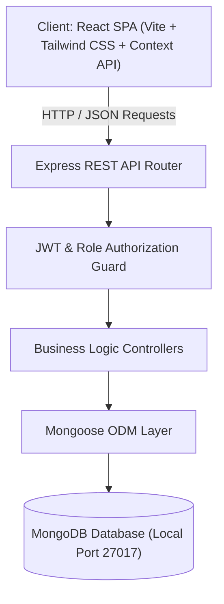

# CAPSTONE PROJECT REPORT

## 1. Title Page & Academic Details

* **Project Title**: RentEasy – Property Rental Listing & Management System
* **Course Title**: Web Development Capstone
* **Academic Semester**: 3rd Semester
* **Student Name**: Om Chaurasia
* **Roll Number**: 2501010063
* **Institution**: KR Mangalam University, Gurugram, Haryana

---

## 2. Abstract & Problem Statement

### 2.1 Abstract
RentEasy is a comprehensive web application developed on the MERN stack (MongoDB, Express, React, Node.js) to address the challenges faced by both prospective tenants and property owners in urban rental markets, specifically focusing on the Gurugram and National Capital Region (NCR). The system delivers role-based access control, property listing lifecycle management, parametric search with range filters, visit scheduling, bookmarking shortlists, and an administrative aggregation pipeline that calculates area-wise average rental prices in real time.

### 2.2 Problem Statement
Finding rental accommodation in expanding urban hubs often involves fragmented information, unverified listings, lack of structured scheduling for property viewings, and opaque rental valuations. RentEasy solves this by providing:
1. Direct communication between verified tenants and owners.
2. A formalized visit-scheduling workflow with status tracking (Pending, Accepted, Declined).
3. Quality control through an administrative approval workflow before public visibility.
4. Transparency in market pricing via MongoDB Aggregation Pipelines calculating average rental rates across specific neighborhoods.

---

## 3. System Architecture & Tech Stack



### 3.1 Technology Stack Selection
* **Frontend**: React 18 with Vite for rapid compilation, React Router DOM v6 for client-side navigation, and Tailwind CSS for mobile-first, responsive user interface design.
* **State Management**: React Context API (`AuthContext` and `SavedContext`) for lightweight, performant global state without third-party overhead.
* **Backend**: Node.js runtime and Express.js framework implementing modular Controller-Route-Middleware architecture.
* **Database**: MongoDB with Mongoose ODM utilizing compound indexes and multi-stage aggregation pipelines.
* **Security**: JWT (JSON Web Tokens) with expiration timers, bcryptjs salted hashing for credential storage, and role-based authorization guards.

---

## 4. Database Schema Design (Main Collections)

### 4.1 User Schema (`users`)
* `name` (String, required): Full name of the user.
* `email` (String, required, unique, indexed): Email address for authentication.
* `password` (String, required, select: false): Bcrypt salted hash.
* `role` (String, enum: `['tenant', 'owner', 'admin']`, default: `'tenant'`).
* `phone` (String): Contact phone number.
* `createdAt` (Date).

### 4.2 Property Schema (`properties`)
* `title` (String, required): Listing title.
* `description` (String, required): Detailed overview.
* `rent` (Number, required, min: 0): Monthly rent in INR.
* `securityDeposit` (Number): Refundable security deposit.
* `location`: Object containing `area`, `city`, `state`, `address`, `zipCode`.
* `propertyType` (String, enum: `['Apartment', 'Independent House', 'Villa', 'Studio', 'PG / Co-living']`).
* `bedrooms` (Number, required): Number of BHK.
* `bathrooms` (Number): Number of bathrooms.
* `furnishingStatus` (String, enum: `['Fully Furnished', 'Semi Furnished', 'Unfurnished']`).
* `amenities` (Array of Strings): Features such as Gym, Pool, Security, Power Backup.
* `images` (Array of Strings): URLs to property photographs.
* `owner` (ObjectId referencing `User`).
* `status` (String, enum: `['pending', 'approved', 'rejected']`, default: `'pending'`).
* `createdAt` (Date).

### 4.3 Enquiry & Visit Schema (`enquiries`)
* `property` (ObjectId referencing `Property`).
* `tenant` (ObjectId referencing `User`).
* `owner` (ObjectId referencing `User`).
* `message` (String, required): Tenant's message.
* `visitDate` (Date): Proposed date for an in-person viewing.
* `phone` (String): Contact number for visit coordination.
* `status` (String, enum: `['pending', 'accepted', 'rejected']`, default: `'pending'`).
* `ownerNotes` (String): Confirmation notes from the owner.
* `createdAt` (Date).

### 4.4 Saved Property Schema (`savedproperties`)
* `tenant` (ObjectId referencing `User`).
* `property` (ObjectId referencing `Property`).
* `savedAt` (Date).
* *Compound Unique Index*: `(tenant: 1, property: 1)` prevents duplicate bookmarks.

---

## 5. MongoDB Aggregation Pipeline Implementation

To fulfill the analytical capstone requirement ("area-wise average rent using aggregation"), a 4-stage pipeline is executed:

```javascript
[
  // Stage 1: Filter only approved public listings
  { $match: { status: 'approved' } },

  // Stage 2: Group by Area & City, compute mathematical aggregates
  {
    $group: {
      _id: { area: '$location.area', city: '$location.city' },
      averageRent: { $avg: '$rent' },
      minRent: { $min: '$rent' },
      maxRent: { $max: '$rent' },
      totalListings: { $sum: 1 },
      avgBedrooms: { $avg: '$bedrooms' }
    }
  },

  // Stage 3: Reshape output and round averages
  {
    $project: {
      _id: 0,
      area: '$_id.area',
      city: '$_id.city',
      averageRent: { $round: ['$averageRent', 2] },
      minRent: '$minRent',
      maxRent: '$maxRent',
      totalListings: '$totalListings',
      avgBedrooms: { $round: ['$avgBedrooms', 1] }
    }
  },

  // Stage 4: Order areas by average rent descending
  { $sort: { averageRent: -1 } }
]
```

---

## 6. Testing & Verification Results

1. **Authentication & RBAC**:
   - Registering a user defaults to `tenant` or `owner`.
   - Admin routes (`/api/admin/*`) return `403 Forbidden` if accessed without an admin JWT.
2. **Search & Filters**:
   - Filter by Rent Range (`minRent=20000&maxRent=45000`) correctly constrains results.
   - Filter by BHK (`bedrooms=2`) accurately limits records.
   - Sorting by `rent_asc` and `rent_desc` validated against MongoDB dataset.
3. **Visit Scheduling**:
   - Tenant submitted visit request for Saturday; Owner dashboard received the request and successfully transitioned state to `accepted`.
4. **Admin Approval & Aggregation**:
   - Pending properties queue allows 1-click approval/rejection.
   - Approved properties instantly reflect in the Area Average Rent Aggregation calculations.

---

## 7. Conclusion

The RentEasy Capstone project demonstrates a production-standard, modular full-stack application fulfilling every mandate of the 3rd Semester Web Development syllabus.

* **Submitted by**: Om Chaurasia (Roll No: 2501010063)  
* **University**: KR Mangalam University  
* **Year**: 2026
